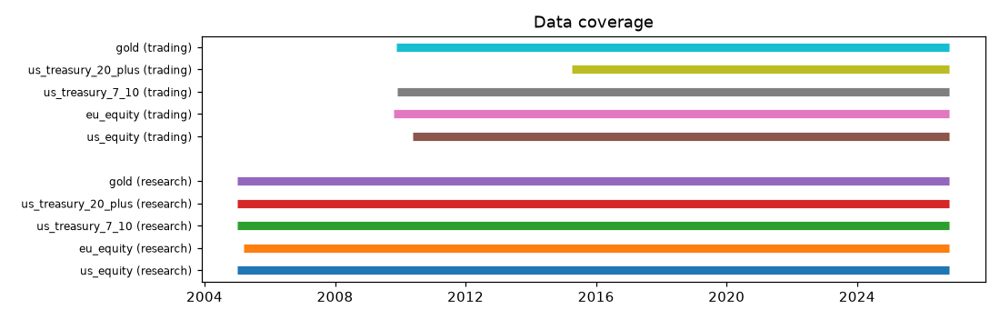
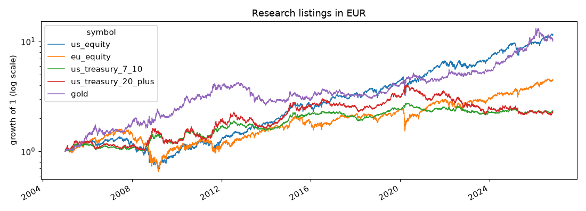
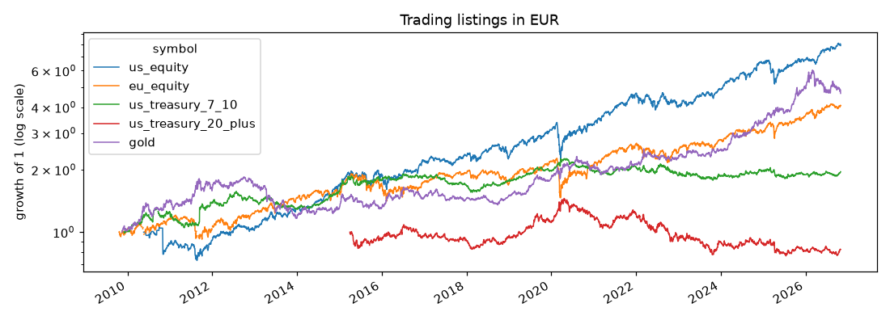
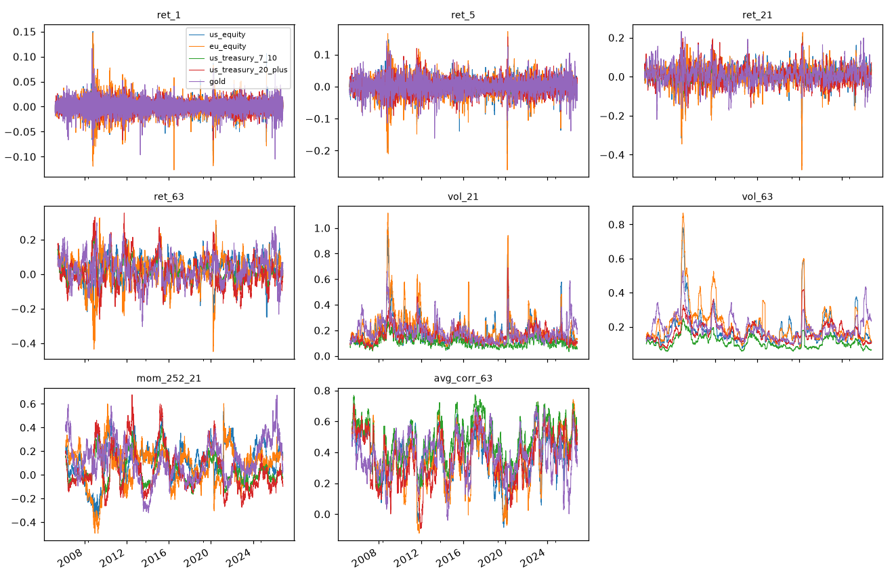
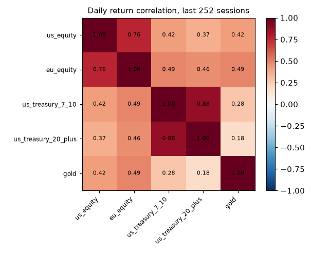

# Phase 1 data report

Base currency: **EUR**. Built from the stored snapshots below; regenerate with `make data-report`.

## Snapshots

| Dataset | Snapshot | Rows | Symbols | First | Last |
|---|---|---|---|---|---|
| daily/yahoo/research | `2f4f81b9e1d6` | 27414 | GLD, IEF, SPY, TLT, VGK | 2005-01-03 | 2026-10-30 |
| daily/yahoo/trading | `3840640642a2` | 19959 | 4GLD.DE, EUNK.DE, IS04.DE, SXR8.DE, SXRM.DE | 2009-10-20 | 2026-10-30 |
| daily/yahoo/fx | `6d9fc3b7d6db` | 5657 | EURUSD=X | 2005-01-04 | 2026-10-31 |

## Coverage and quality

### research

|     | first                   | last                    |   years |   bars |   expected_sessions |   missing_sessions |   largest_gap_sessions |   errors |   warnings |
|:----|:------------------------|:------------------------|--------:|-------:|--------------------:|-------------------:|-----------------------:|---------:|-----------:|
| GLD | 2005-01-03T00:00:00.000 | 2026-10-30T00:00:00.000 |    21.8 |   5492 |                5492 |                  0 |                      0 |        0 |          0 |
| IEF | 2005-01-03T00:00:00.000 | 2026-10-30T00:00:00.000 |    21.8 |   5492 |                5492 |                  0 |                      0 |        0 |          1 |
| SPY | 2005-01-03T00:00:00.000 | 2026-10-30T00:00:00.000 |    21.8 |   5492 |                5492 |                  0 |                      0 |        0 |          1 |
| TLT | 2005-01-03T00:00:00.000 | 2026-10-30T00:00:00.000 |    21.8 |   5492 |                5492 |                  0 |                      0 |        0 |          1 |
| VGK | 2005-03-10T00:00:00.000 | 2026-10-30T00:00:00.000 |    21.6 |   5446 |                5446 |                  0 |                      0 |        0 |          1 |

4 issue(s):

| symbol   | check             | severity   | detail                                          | timestamp                |
|:---------|:------------------|:-----------|:------------------------------------------------|:-------------------------|
| IEF      | ohlc_inconsistent | warning    | 17 bars where high/low don't bracket open/close | 2005-03-31T21:00:00.000Z |
| SPY      | ohlc_inconsistent | warning    | 2 bars where high/low don't bracket open/close  | 2012-07-31T20:00:00.000Z |
| TLT      | ohlc_inconsistent | warning    | 18 bars where high/low don't bracket open/close | 2005-09-23T20:00:00.000Z |
| VGK      | ohlc_inconsistent | warning    | 17 bars where high/low don't bracket open/close | 2008-09-09T20:00:00.000Z |

### trading

|         | first                   | last                    |   years |   bars |   expected_sessions |   missing_sessions |   largest_gap_sessions |   errors |   warnings |
|:--------|:------------------------|:------------------------|--------:|-------:|--------------------:|-------------------:|-----------------------:|---------:|-----------:|
| 4GLD.DE | 2009-11-13T00:00:00.000 | 2026-10-30T00:00:00.000 |    17   |   4305 |                4307 |                  5 |                      1 |        0 |          3 |
| EUNK.DE | 2009-10-20T00:00:00.000 | 2026-10-30T00:00:00.000 |    17   |   4252 |                4325 |                 77 |                      4 |        1 |          1 |
| IS04.DE | 2015-04-01T00:00:00.000 | 2026-10-30T00:00:00.000 |    11.6 |   2940 |                2940 |                  4 |                      1 |        0 |          3 |
| SXR8.DE | 2010-05-19T00:00:00.000 | 2026-10-30T00:00:00.000 |    16.4 |   4180 |                4180 |                  5 |                      1 |        0 |          4 |
| SXRM.DE | 2009-12-01T00:00:00.000 | 2026-10-30T00:00:00.000 |    16.9 |   4282 |                4295 |                 18 |                     10 |        0 |          3 |

15 issue(s):

| symbol   | check             | severity   | detail                                                       | timestamp                |
|:---------|:------------------|:-----------|:-------------------------------------------------------------|:-------------------------|
| 4GLD.DE  | non_session_bars  | warning    | 3 bars on days the exchange is closed                        | 2017-10-03T12:00:00.000Z |
| 4GLD.DE  | missing_sessions  | warning    | 5 of 4307 sessions missing (0.12%)                           | 2011-10-03T00:00:00.000  |
| 4GLD.DE  | ohlc_inconsistent | warning    | 2 bars where high/low don't bracket open/close               | 2017-06-26T15:30:00.000Z |
| EUNK.DE  | non_session_bars  | warning    | 4 bars on days the exchange is closed                        | 2017-06-05T12:00:00.000Z |
| EUNK.DE  | missing_sessions  | error      | 77 of 4325 sessions missing (1.78%)                          | 2009-10-29T00:00:00.000  |
| IS04.DE  | non_session_bars  | warning    | 4 bars on days the exchange is closed                        | 2017-06-05T12:00:00.000Z |
| IS04.DE  | missing_sessions  | warning    | 4 of 2940 sessions missing (0.14%)                           | 2015-09-16T00:00:00.000  |
| IS04.DE  | ohlc_inconsistent | warning    | 27 bars where high/low don't bracket open/close              | 2015-09-30T15:30:00.000Z |
| SXR8.DE  | non_session_bars  | warning    | 5 bars on days the exchange is closed                        | 2015-12-25T12:00:00.000Z |
| SXR8.DE  | missing_sessions  | warning    | 5 of 4180 sessions missing (0.12%)                           | 2011-10-03T00:00:00.000  |
| SXR8.DE  | stale_prices      | warning    | 8 runs of >= 5 sessions with an unchanged close              | 2010-05-19T15:30:00.000Z |
| SXR8.DE  | jump              | warning    | large move (check for an unadjusted split): log return -0.28 | 2010-11-01T16:30:00.000Z |
| SXRM.DE  | non_session_bars  | warning    | 5 bars on days the exchange is closed                        | 2015-12-25T12:00:00.000Z |
| SXRM.DE  | missing_sessions  | warning    | 18 of 4295 sessions missing (0.42%)                          | 2010-09-06T00:00:00.000  |
| SXRM.DE  | stale_prices      | warning    | 38 runs of >= 5 sessions with an unchanged close             | 2010-03-04T16:30:00.000Z |

2 bad print(s) dropped before storing:

| timestamp                 | symbol   |
|:--------------------------|:---------|
| 2009-11-11T16:30:00+00:00 | EUNK.DE  |
| 2009-11-12T16:30:00+00:00 | EUNK.DE  |

### fx

|          | first                   | last                    |   years |   bars |   expected_sessions |   missing_sessions |   largest_gap_sessions |   errors |   warnings |
|:---------|:------------------------|:------------------------|--------:|-------:|--------------------:|-------------------:|-----------------------:|---------:|-----------:|
| EURUSD=X | 2005-01-03T00:00:00.000 | 2026-10-30T00:00:00.000 |    21.8 |   5657 |                5695 |                 38 |                     11 |        0 |          2 |

2 issue(s):

| symbol   | check             | severity   | detail                                           | timestamp                |
|:---------|:------------------|:-----------|:-------------------------------------------------|:-------------------------|
| EURUSD=X | missing_sessions  | warning    | 38 of 5695 sessions missing (0.67%)              | 2005-09-21T00:00:00.000  |
| EURUSD=X | ohlc_inconsistent | warning    | 126 bars where high/low don't bracket open/close | 2005-06-15T00:00:00.000Z |

5 bad print(s) dropped before storing:

| timestamp                 | symbol   |
|:--------------------------|:---------|
| 2008-01-09T00:00:00+00:00 | EURUSD=X |
| 2008-02-09T00:00:00+00:00 | EURUSD=X |
| 2008-09-09T00:00:00+00:00 | EURUSD=X |
| 2008-10-09T00:00:00+00:00 | EURUSD=X |
| 2008-12-09T00:00:00+00:00 | EURUSD=X |

## Research vs trading listings

Does each UCITS listing track its research ETF? Weekly returns in EUR, over the weeks both exist.

| asset               | overlap_from   |   weeks |   weekly_return_corr |   ann_return_diff_pct |   tracking_error_pct |
|:--------------------|:---------------|--------:|---------------------:|----------------------:|---------------------:|
| us_equity           | 2010-05-28     |     858 |                0.716 |                 -1.62 |                12.67 |
| eu_equity           | 2009-10-30     |     888 |                0.85  |                 -0.18 |                 9.83 |
| us_treasury_7_10    | 2009-12-11     |     880 |                0.874 |                 -0.08 |                 5.2  |
| us_treasury_20_plus | 2015-04-10     |     604 |                0.846 |                  0.06 |                 8.21 |
| gold                | 2009-11-20     |     885 |                0.848 |                  0.45 |                 8.62 |

## Feature sanity checks (research listings, decision-time aligned)

Feature summary over the full history:

|                                        |   count |   mean |    std |     min |     25% |     50% |    75% |    max |
|:---------------------------------------|--------:|-------:|-------:|--------:|--------:|--------:|-------:|-------:|
| ('ret_1', 'us_equity')                 |    5444 | 0.0004 | 0.0131 | -0.1091 | -0.0056 |  0.0008 | 0.007  | 0.1504 |
| ('ret_1', 'eu_equity')                 |    5444 | 0.0003 | 0.0153 | -0.1267 | -0.0069 |  0.0007 | 0.008  | 0.1475 |
| ('ret_1', 'us_treasury_7_10')          |    5444 | 0.0002 | 0.0072 | -0.0374 | -0.004  |  0.0001 | 0.0042 | 0.0399 |
| ('ret_1', 'us_treasury_20_plus')       |    5444 | 0.0001 | 0.0109 | -0.067  | -0.0061 |  0.0005 | 0.0065 | 0.0774 |
| ('ret_1', 'gold')                      |    5444 | 0.0004 | 0.0128 | -0.1051 | -0.0063 |  0.0006 | 0.0076 | 0.1164 |
| ('ret_5', 'us_equity')                 |    5440 | 0.0022 | 0.0248 | -0.2102 | -0.0095 |  0.0039 | 0.0162 | 0.1466 |
| ('ret_5', 'eu_equity')                 |    5440 | 0.0014 | 0.0278 | -0.2606 | -0.0115 |  0.0033 | 0.0165 | 0.1723 |
| ('ret_5', 'us_treasury_7_10')          |    5440 | 0.0008 | 0.0149 | -0.0681 | -0.0081 |  0.0004 | 0.0091 | 0.0874 |
| ('ret_5', 'us_treasury_20_plus')       |    5440 | 0.0007 | 0.0228 | -0.0911 | -0.0131 |  0.0006 | 0.014  | 0.155  |
| ('ret_5', 'gold')                      |    5440 | 0.0021 | 0.0251 | -0.1617 | -0.0119 |  0.0024 | 0.0165 | 0.142  |
| ('ret_21', 'us_equity')                |    5424 | 0.0094 | 0.0473 | -0.3965 | -0.0124 |  0.0135 | 0.0378 | 0.2068 |
| ('ret_21', 'eu_equity')                |    5424 | 0.0057 | 0.0506 | -0.4783 | -0.0162 |  0.0117 | 0.0349 | 0.2272 |
| ('ret_21', 'us_treasury_7_10')         |    5424 | 0.0032 | 0.0291 | -0.1104 | -0.0151 |  0.0015 | 0.0193 | 0.1561 |
| ('ret_21', 'us_treasury_20_plus')      |    5424 | 0.0029 | 0.0448 | -0.1609 | -0.026  |  0.0006 | 0.0278 | 0.1966 |
| ('ret_21', 'gold')                     |    5424 | 0.009  | 0.0471 | -0.2195 | -0.0197 |  0.0067 | 0.0364 | 0.2321 |
| ('ret_63', 'us_equity')                |    5382 | 0.0279 | 0.0741 | -0.3504 | -0.0139 |  0.0366 | 0.0785 | 0.2854 |
| ('ret_63', 'eu_equity')                |    5382 | 0.0174 | 0.0814 | -0.4487 | -0.0167 |  0.0294 | 0.0666 | 0.3258 |
| ('ret_63', 'us_treasury_7_10')         |    5382 | 0.009  | 0.0537 | -0.1777 | -0.025  |  0.0035 | 0.0369 | 0.2516 |
| ('ret_63', 'us_treasury_20_plus')      |    5382 | 0.0081 | 0.0829 | -0.2619 | -0.0456 | -0.0008 | 0.0537 | 0.3539 |
| ('ret_63', 'gold')                     |    5382 | 0.0273 | 0.0751 | -0.3037 | -0.0233 |  0.0258 | 0.0739 | 0.298  |
| ('vol_21', 'us_equity')                |    5424 | 0.1787 | 0.1103 |  0.0488 |  0.1173 |  0.1492 | 0.2027 | 1.0084 |
| ('vol_21', 'eu_equity')                |    5424 | 0.2106 | 0.127  |  0.0631 |  0.1361 |  0.1746 | 0.2436 | 1.1164 |
| ('vol_21', 'us_treasury_7_10')         |    5424 | 0.1071 | 0.0397 |  0.0333 |  0.0783 |  0.0983 | 0.1267 | 0.2898 |
| ('vol_21', 'us_treasury_20_plus')      |    5424 | 0.1621 | 0.0633 |  0.0461 |  0.1202 |  0.1495 | 0.1907 | 0.6888 |
| ('vol_21', 'gold')                     |    5424 | 0.1893 | 0.0785 |  0.068  |  0.1373 |  0.1693 | 0.2241 | 0.6628 |
| ('vol_63', 'us_equity')                |    5382 | 0.184  | 0.1    |  0.0722 |  0.1278 |  0.1554 | 0.2038 | 0.7816 |
| ('vol_63', 'eu_equity')                |    5382 | 0.2161 | 0.115  |  0.0747 |  0.144  |  0.1825 | 0.2495 | 0.8668 |
| ('vol_63', 'us_treasury_7_10')         |    5382 | 0.1084 | 0.035  |  0.0541 |  0.082  |  0.1005 | 0.131  | 0.2482 |
| ('vol_63', 'us_treasury_20_plus')      |    5382 | 0.1646 | 0.0554 |  0.0699 |  0.1257 |  0.1529 | 0.1971 | 0.4185 |
| ('vol_63', 'gold')                     |    5382 | 0.1924 | 0.0681 |  0.0912 |  0.1429 |  0.1796 | 0.2225 | 0.5283 |
| ('mom_252_21', 'us_equity')            |    5193 | 0.1139 | 0.1509 | -0.407  |  0.0322 |  0.1199 | 0.2144 | 0.5707 |
| ('mom_252_21', 'eu_equity')            |    5193 | 0.0744 | 0.1577 | -0.4942 | -0.0153 |  0.108  | 0.1716 | 0.6024 |
| ('mom_252_21', 'us_treasury_7_10')     |    5193 | 0.0383 | 0.1134 | -0.1654 | -0.042  |  0.014  | 0.1104 | 0.4101 |
| ('mom_252_21', 'us_treasury_20_plus')  |    5193 | 0.043  | 0.1738 | -0.2744 | -0.0817 | -0.0004 | 0.1441 | 0.6768 |
| ('mom_252_21', 'gold')                 |    5193 | 0.1171 | 0.1621 | -0.3215 |  0.0088 |  0.1046 | 0.2241 | 0.6732 |
| ('avg_corr_63', 'us_equity')           |    5382 | 0.3702 | 0.1533 | -0.0868 |  0.2582 |  0.3847 | 0.4936 | 0.6931 |
| ('avg_corr_63', 'eu_equity')           |    5382 | 0.3743 | 0.1699 | -0.1242 |  0.2567 |  0.3744 | 0.5182 | 0.742  |
| ('avg_corr_63', 'us_treasury_7_10')    |    5382 | 0.4731 | 0.1396 |  0.0628 |  0.3741 |  0.4778 | 0.5825 | 0.7728 |
| ('avg_corr_63', 'us_treasury_20_plus') |    5382 | 0.3668 | 0.1519 | -0.0949 |  0.2492 |  0.3669 | 0.4995 | 0.7151 |
| ('avg_corr_63', 'gold')                |    5382 | 0.3813 | 0.1332 | -0.0404 |  0.2969 |  0.3797 | 0.4698 | 0.6977 |

